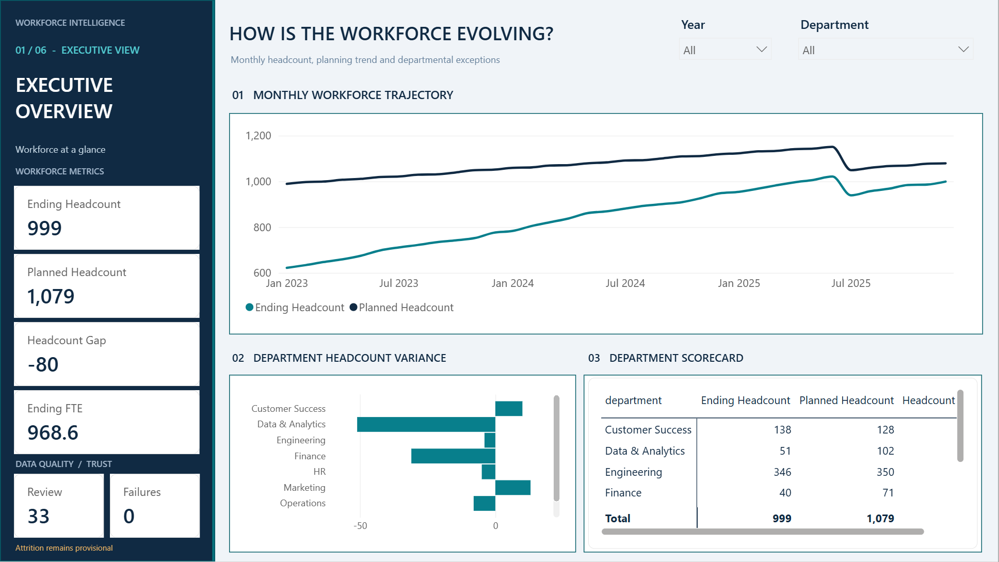
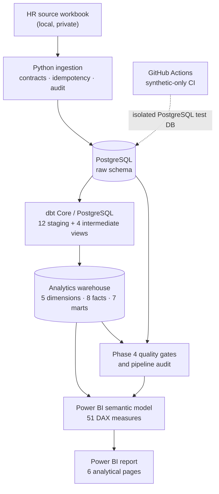

# HR Workforce Intelligence

[](https://github.com/thaquan/Workforce_Management/actions/workflows/quality-ci.yml)

**End-to-end Data Engineering + Power BI portfolio project** for workforce planning, attrition, retention, recruitment operations, and data quality.

**Status:** Phases **1–5 implemented**. Six Power BI report pages and 51 DAX measures have been validated locally. GitHub Actions uses **invented synthetic HR data**; the real HR workbook and imported employee records are not in this repository.

> This project is a historical workforce analytics case study, **not a live HR system**. Its available business-data period is January 2023–December 2025.

## Dashboard preview and portfolio

[](docs/portfolio/README.md)

**[Explore all six dashboard pages](docs/portfolio/README.md)** · [Full project case study](docs/portfolio/case_study.md) · [Architecture and data trust](docs/portfolio/architecture.md) · [Demo walkthrough](docs/portfolio/demo_walkthrough.md) · [CV bullets](docs/portfolio/cv_bullets.md)

The screenshot gallery contains **aggregate, historical Power BI Desktop views**, not employee-level data. The owner has published a Power BI Service version, but a permission-reviewed public URL has not been supplied to this repository; no public report link is invented here.

## What the project solves

HR stakeholders need a consistent way to monitor staffing plans, headcount and FTE, employee exits, recruitment throughput and data reliability. This project turns a multi-sheet workbook into a documented and tested PostgreSQL/dbt analytics warehouse, and exposes business metrics through a six-page Power BI semantic model and report.

**Selected source-baseline facts:**

| Metric | Verified value |
|---|---:|
| Source data | 12 sheets / 29,728 records |
| Employees in source | 1,200 |
| Workforce reporting period | 36 months (2023-01 through 2025-12) |
| December 2025 actual vs planned headcount | 999 vs 1,079 (**gap −80**) |
| December 2025 actual vs budgeted FTE | 968.6 vs 1,053.8 |
| Historical headcount reconciliation requiring review | **33 of 36 months** |
| Largest noted discrepancy (June 2025) | **+98** snapshot minus employee-as-of |

These numbers reflect the supplied *historical* dataset; they are **not current workforce metrics** or independently validated real-world employment figures.

## Architecture



**Stack:** Python 3.13 · PostgreSQL 17 · Docker Compose · dbt Core 1.12 / dbt-postgres 1.11 · SQL · Power BI Desktop/Service · DAX · GitHub Actions · Git.

The local production-like pipeline remains inexpensive: no mandatory cloud warehouse, managed orchestrator or paid monitoring subscription. The published Power BI Service report is managed separately by the project owner; source control does **not** automatically refresh or republish it.

## Delivered phases

| Phase | Delivered | Implementation / evidence |
|---|---|---|
| **1 — Source profiling** | 12-sheet quality review, ERD, grain and KPI mapping | [Phase 1 documents](docs/phase1/), [quality decisions](docs/phase1/06_review_resolutions.md) |
| **2 — Ingestion** | 12 typed raw tables, transactional loads, SHA-256 audit, idempotency and recovery | [Phase 2 handoff](docs/phase2/README.md), [code review](docs/phase2/04_code_review_fixes.md) |
| **3 — Analytics warehouse** | 36 dbt models and **83 data tests** (full-data baseline); generated lineage | [Phase 3 handoff](docs/phase3/README.md), [KPI contracts](docs/phase3/02_kpi_semantics.md) |
| **4 — Quality & operations** | **18 executable quality checks**, persisted audit, safe rollback tests and synthetic CI | [Phase 4 handoff](docs/phase4/README.md), [acceptance](reports/phase4/acceptance_report.md) |
| **5 — Power BI** | **51 DAX measures**, six editable PBIR dashboard pages and report checks | [Power BI setup](powerbi/README.md), [report documentation](docs/phase5/README.md), [validation summary](reports/phase5/validation_summary.md) |

### Six Power BI report pages

| Page | Business question | Main visualization |
|---|---|---|
| **01 — Executive Overview** | What is the overall workforce position? | Headcount trajectory, department gap ranking, scorecard |
| **02 — Workforce Planning** | Which departments are above/below workforce plan? | Waterfall, planned-capacity treemap, attainment gauge |
| **03 — Attrition Analysis** | When and where do recorded exits cluster? | Department×month rate heatmap, hires/exits, exit composition |
| **04 — Retention & Engagement** | How do observed Active/Exited cohorts differ? | Department bubble scatter, descriptive cohort comparisons |
| **05 — Recruitment Performance** | How are hiring throughput, backlog and speed changing? | Closed-request area, days-to-fill bubble scatter, department backlog |
| **06 — Data Quality & Trust** | Did the pipeline run and can its outputs be trusted? | Quality status strip, reconciliation trend, audit/quality register |

Pages share the **Navy–Teal identity and navigation shell** but use different visual layouts. Read the [Power BI documentation](docs/phase5/README.md) and open the editable **[`powerbi/WorkforceIntelligence.pbip`](powerbi/WorkforceIntelligence.pbip)** in Power BI Desktop.

## Reproduce locally with an authorized source workbook

> **Important:** The HR workbook is intentionally absent from Git. Running the *full real-data pipeline* requires an authorized local copy of `HR_Workforce_Planning_Attrition_Dataset.xlsx`. Do not upload private HR data, connection credentials, or Power BI import caches to this repository.

Prerequisites: **Python 3.13**, **Docker Desktop** with Compose, and **Power BI Desktop** (Windows). From the repository root:

```powershell
git clone https://github.com/thaquan/Workforce_Management.git
cd Workforce_Management

Copy-Item .env.example .env
# Edit .env locally: configure POSTGRES_PASSWORD and related PostgreSQL values.
# Keep .env private and do not commit it.

python -m venv .venv
.\.venv\Scripts\Activate.ps1
python -m pip install -r requirements.txt -r requirements-dbt.txt

docker compose up -d postgres
# Place your authorized workbook at:
# data/raw/HR_Workforce_Planning_Attrition_Dataset.xlsx

python -m src.phase4.pipeline
python -m src.phase4.health
python -m src.phase3.dbt_runner docs generate
```

The Phase 4 runner performs **Python ingestion → dbt build/tests → quality gates → audited status**. To inspect a previous warehouse without reloading source data, run `python -m src.phase4.pipeline --quality-only`. dbt docs can be served with `python -m src.phase3.dbt_runner docs serve --port 8080` (open `http://localhost:8080`).

Open `powerbi/WorkforceIntelligence.pbip` in Power BI Desktop and configure/refresh its PostgreSQL data source (normally `127.0.0.1:5433`, database `workforce_dw`; credentials are private). The PBIP source includes the report and semantic model definition, **not** cached employee data. Power BI Service refresh from local PostgreSQL requires appropriate gateway/connectivity and refresh configuration; publishing the report alone does not configure automatic refresh.

For source profiling alone, use `python src/phase1/run_phase1.py`. The detailed setup, modeling and troubleshooting instructions live in [`docs/phase2/`](docs/phase2/), [`docs/phase3/`](docs/phase3/) and [`docs/phase4/`](docs/phase4/).

## Quality assurance and GitHub Actions

The [Quality Gates (Synthetic CI) workflow](.github/workflows/quality-ci.yml) executes on pushes to `main` and on pull requests, using a short-lived **PostgreSQL 17 service with only invented fixture rows**:

1. Install pinned Python/dbt packages and run Phase 2–4 static checks plus **all Phase 5 offline tests** (semantic model, six PBIR pages and privacy guardrails).
2. Seed the isolated synthetic source database.
3. Build **36 dbt models + 80 non-baseline data tests**; workbook-specific baseline tests are intentionally excluded.
4. Run the auditable Phase 4 quality gates and destructive/recovery regression tests **only against the isolated synthetic database**.
5. Verify Dagster Phase 7 and Phase 8 offline contracts plus isolated PostgreSQL orchestration and transactional incremental recovery.
6. Generate dbt catalog/lineage docs. A failing test blocks CI.

The GitHub runner installs dbt in its Python environment and invokes the **`dbt` CLI directly**. The local `src.phase3.dbt_runner` is for a project `.venv` and is not called from CI. No production/real workbook access is required for synthetic CI. The workflow badge at the top reflects the latest GitHub run; successful local testing does not by itself establish a successful hosted run.

To test Power BI source definitions without a live Desktop session:

```powershell
python -m unittest discover -s tests -p "test_phase5_*.py" -v
```

To check calculations against actual imported data, run [`powerbi/dax/validation_queries.dax`](powerbi/dax/validation_queries.dax) in Power BI Desktop's DAX Query View. GitHub CI checks report/model structure but does **not** execute a live Power BI engine.

## Data trust and limitations

The project keeps data-quality constraints visible rather than silently rewriting source facts:

- **33/36 months** have a mismatch between workforce snapshot headcount and an employee-as-of reconciliation. June 2025 differs by **+98** and December 2025 by **+5**. Attrition rates are flagged **provisional**; January 2023 is `BLANK` because the preceding month is unavailable.
- The original source date dimension is shorter than the employee history; the warehouse derives a complete calendar without editing raw data.
- Salary-budget period/currency/coverage have not been verified. **Salary-budget variance is deliberately disabled**.
- No historical department transfer events or effective-dated department assignments are provided. The report does **not** invent internal-mobility trends or a historical SCD Type 2 dimension.
- Recruitment open requisitions are a **latest-period stock**; filled/cancelled requisitions are **period flows**. Retention cohort comparisons are observational, **not causal**.
- Pipeline `SUCCEEDED` means its technical checks completed, **not** that all historical source limitations disappeared. The Power BI audit page is an **Import-mode snapshot**, not a live monitoring service.

## Repository layout

```text
.github/workflows/       Synthetic-only CI
src/phase1/              Source profiling
src/phase2/              Validated/idempotent ingestion
src/phase3/              dbt runner and staging generation
src/phase4/              Quality gates, audit and synthetic fixture
src/phase5/              Read-only semantic model, report and SQL checks
src/phase7/              Dagster orchestration (isolated synthetic)
src/phase8/              Incremental changes, Parquet, Dagster and audit
dbt_hr/                  dbt project: sources, staging, marts, tests
sql/                     PostgreSQL bootstrap and monitoring DDL
powerbi/                 PBIP/PBIR source, DAX measures and design theme
tests/                   Unit, integration, recovery and report tests
docs/phase1..phase5/     Architecture, semantics and runbooks
docs/phase7..phase8/     Synthetic orchestration and incremental runbooks
reports/phase1..phase5/  Non-sensitive verification evidence
reports/phase7..phase8/  Synthetic validation evidence
data/raw/                LOCAL ONLY; intentionally ignored by Git
```

## Phase 8 - Incremental events and Parquet (synthetic demo)

Phase 8 demonstrates immutable Parquet change batches, ordered source-offset watermarking, audited PostgreSQL UPSERTs, idempotent batch replay, late-event and logical-delete handling, and a separate four-asset Dagster graph. No real HR workbook, existing warehouse schemas or Power BI data are touched. Dry-run is the default.

See [Phase 8 runbook](docs/phase8/README.md) for setup, permissions, local demo and acceptance checks. This is a fictional change-stream exercise, not live CDC or automatic Power BI refresh.

## Phase 7 - Dagster OSS orchestration (synthetic preview)

A five-asset Dagster graph is available in src/phase7/ with a **no-database dry-run by default**. It provides source fingerprinting, idempotent synthetic raw checks, dbt model/test execution, audited Phase 4 quality gates, a report-ready marker, bounded transient retries and a weekly schedule disabled by default. The existing private-workbook pipeline and Power BI Service refresh are independent.

Start with the optional requirements-dagster.txt dependencies and run the Phase 7 CLI. See [Phase 7 runbook](docs/phase7/README.md) for exact setup, safe synthetic PostgreSQL demonstration, UI and verification. This is a portfolio orchestration example, **not** a live source refresh.

## Next steps

The initial analytics platform and dashboard are complete. The six-page screenshot gallery, project case study and interview/demo documentation are available under [docs/portfolio/](docs/portfolio/README.md).

**Now implemented as a synthetic preview:** [Dagster OSS orchestration](docs/phase7/README.md) for dependency lineage, opt-in synthetic runs, retries and disabled-by-default scheduling. **Also implemented:** [Phase 8 fictional incremental event batches](docs/phase8/README.md) with Parquet, source offsets, idempotent UPSERTs and quality audit. **Still planned:** full-load vs incremental synthetic performance comparisons at larger scale (including DuckDB), a validated real source-change contract, and clearly labeled Power BI What-if scenarios. Cloud migration is **optional**, not a requirement for reproducing the project. No GitHub Release or version tag is required for this repository's portfolio documentation.

**Privacy:** Do not commit `.env`, credentials, original HR workbooks, employee-level extracts, `.pbi` import caches, or generated database files. The GitHub Actions fixture uses fictional IDs and values. Any public demo or screenshot must use authorized aggregated information or synthetic data only.
