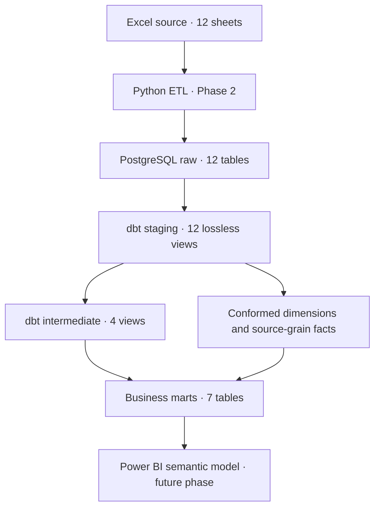

# Phase 3 Architecture and Data Grain

## Logical flow

Source schema contract: `src/phase2/schema_contract.py`.
Staging files and YAML are reproducibly generated using
`python -m src.phase3.generate_staging`.
dbt project: `dbt_hr/`; local config: `dbt_hr/profiles.yml`.
Credentials are supplied via environment variables, not hardcoded.

## Facts and cardinality

| Object | Grain | Rows (verified workbook) |
|---|---|---:|
| `fct_workforce_snapshot` | Month × Department × Location × Level | 6,826 |
| `fct_employee_events` | Employee × EventDate × EventType | 1,406 |
| `fct_compensation_versions` | Employee × EffectiveDate | 2,914 |
| `fct_performance_reviews` | Employee × ReviewDate | 2,741 |
| `fct_engagement_surveys` | Employee × SurveyDate | 10,200 |
| `fct_absences` | Employee × AbsenceDate × AbsenceType | 2,755 |
| `fct_recruitment_monthly` | Month × Department | 288 |
| `fct_workforce_targets` | Month × Department | 288 |

Five dimensions: `dim_date` (daily, 2,918 dates from 2018-01-05);
`dim_department` (8), `dim_location` (6), `dim_level` (5),
`dim_employee` (1,200 current/end-state profiles).

The monthly snapshot **does not have EmployeeID**. Join snapshot to workforce
targets only after reducing snapshot to Month × Department. The recruitment
table is also an aggregate; `ReqID` is not a candidate identifier.
Never join employee-level survey or salary history directly to the
monthly department/location/level snapshot; such joins would duplicate facts.

## Business marts

| Model | Grain | Usage |
|---|---|---|
| `mart_workforce_monthly` | Month × Dept × Location × Level | Monthly ending HC/FTE and tenure |
| `mart_attrition_monthly` | Month × Dept | Hires, departures and provisional rates |
| `mart_workforce_plan_vs_actual` | Month × Dept | HC/FTE plans and gaps |
| `mart_recruitment_monthly` | Month × Dept | Recruitment stock/flow, weighted fill times |
| `mart_retention_analysis` | Employee × one observation endpoint | Last eligible pre-exit features |
| `mart_workforce_reconciliation` | Month | Snapshot vs employee-date reference |
| `mart_salary_run_rate_monthly` | Month | Eligible latest annual salary versions, EUR |

All staging/intermediate objects are views; all dimensions, facts and marts
are PostgreSQL tables. For this small input, fully materialized tables
avoid unnecessary incremental state and maintenance.

## Privacy note

`dim_employee`, `mart_retention_analysis` and the employee-level facts
contain private rows in the local database. **Do not export them as CSV,
screenshots or published dbt docs containing real row samples.** The Git
repository contains SQL definitions and aggregate-only verification evidence.
