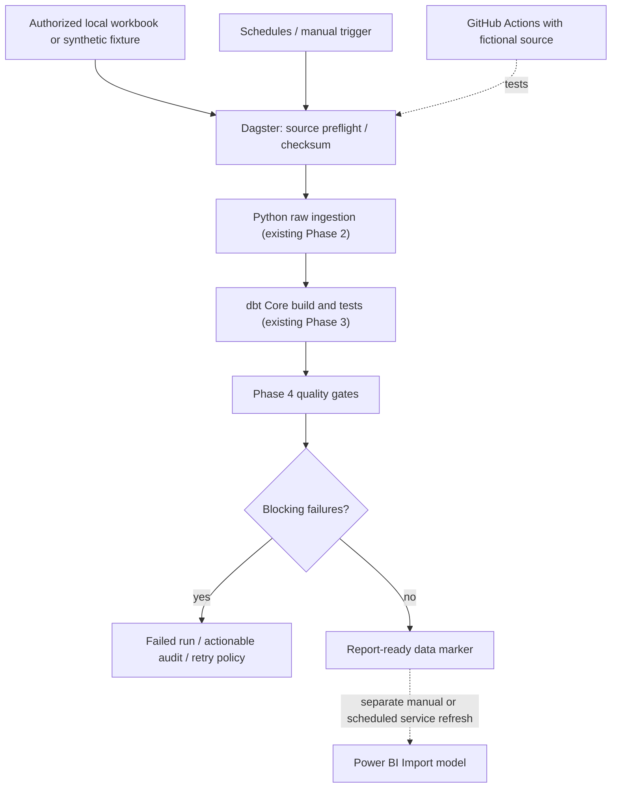

# Phase 7 Proposal — Dagster OSS Orchestration (Not Yet Implemented)

**Status:** Proposed extension after completing the Phases 1–5 data platform, Power BI report, GitHub Actions and portfolio documentation. This document is a *plan*, not proof that Dagster is installed or running.

## Objective

Turn the existing manually invoked Python ingestion → dbt build/test → Phase 4 quality gates into **observable, reproducible, scheduled orchestration** with explicit dependencies, retries and run records. Reuse the current tested jobs rather than rewriting working ingestion and SQL logic.

Keep costs low: **Dagster open source, local Python/Docker, PostgreSQL and dbt Core**. A commercial orchestrator or managed cloud environment is not required for the initial scope.

## Proposed architecture

The Dagster layer orchestrates **already existing functions/CLI jobs**. It must not use a synthetic fixture against the private `workforce_dw` database or silently approve source REVIEW issues. The latest Power BI Service refresh remains independent until a safely configured gateway and service-refresh process are available.

## Proposed tools and responsibilities

| Tool | Why | Scope |
|---|---|---|
| **Dagster OSS** | Data asset lineage, dependency scheduling, run metadata, retry and status UI | New Phase 7 orchestrator |
| **Python (current project)** | Typed ingestion, idempotency and source-audit contracts | Reuse Phases 1–4, no algorithm rewrite |
| **PostgreSQL + Docker Compose** | Existing raw/marts/audit schemas | Preserve historical source |
| **dbt Core / dbt-postgres** | Modeling, data tests, lineage | Continue pinned 1.12 toolchain until tested upgrade |
| **GitHub Actions** | Synthetic CI and code-quality gates | Add Dagster asset-definition tests; do not start recurring production schedules in CI |
| **Power BI Service + gateway (optional)** | Consumable refreshed BI model | Separate authorization and connectivity configuration |

The Dagster integration package/version should be selected and compatibility-tested against the pinned dbt version **before implementation**. A simple subprocess adapter is a viable first milestone if the native integration is incompatible.

## Delivery plan

### 7.1 — Asset-based minimum viable orchestrator

- New package `src/phase7/` or `orchestration/`, separate requirements file and Dagster definitions; no destructive edits to Phase 4 runner.
- Assets: `source_preflight` → `raw_ingested` → `dbt_marts_built` → `quality_gates_checked` → `report_ready`.
- Pass the original pipeline audit run ID and elapsed time as metadata.
- Use injected database resources/environment, not hardcoded passwords.
- A default `dry-run` or synthetic mode should be safe to execute without a private workbook.

**Acceptance:** one controlled run on a disposable synthetic PostgreSQL DB yields a complete dependency graph, run ID and PASS/REVIEW/FAIL evidence; failed upstream steps block downstream runs.

### 7.2 — Reliability and failure demonstrations

- Run retries only for transient infrastructure/connection faults; **do not retry non-recoverable schema drift** forever.
- Establish exactly-once *business effects* via existing idempotent ingestion, not unsupported exactly-once delivery claims.
- Record source checksums, affected model count, quality statuses and failure reasons.
- Demonstrate recoverability on isolated synthetic data; avoid corrupting the local authoritative workbook or analytics DB.

**Acceptance:** duplicate inputs do not duplicate data; one simulated transient failure recovers within a bounded retry budget; one schema failure clearly blocks `report_ready`.

### 7.3 — Scheduling and freshness

- A local daily/weekly schedule is configured but **disabled by default** until a reliable source-update process exists.
- Establish a freshness rule distinguishing **source latest period** from **time of pipeline run**.
- If a file sensor is introduced, verify checksum changes before triggering another full ingestion.
- Add explicit documentation for machine availability: a local Dagster process and database must remain running for scheduled jobs to execute.

**Acceptance:** manually enabled schedule/sensor triggers one verified test run; unchanged input is skipped/idempotent; no duplicate source records.

### 7.4 — Documentation, monitoring and CI

- Add CLI setup/runbook, screenshots of Dagster asset lineage (with fictional fixture, not private HR rows) and clean teardown instructions.
- Add **offline** asset-definition tests plus **isolated synthetic** integration checks to GitHub Actions.
- Keep the existing `Quality Gates (Synthetic CI)` pipeline passing, and document the cost of any additional hosted runner minutes.
- Document safe PostgreSQL credentials and how to operate the Power BI gateway independently.

**Acceptance:** no raw/private data tracked in Git, all existing Phase 2–5 tests pass, CI is green and orchestration code can be reproduced without the original workbook.

## Recommended order and effort

1. **Asset graph + manual synthetic run:** 2–3 working days.
2. **Retry/idempotency/failure handling:** 2–3 working days.
3. **Optional local scheduler/sensor and freshness contracts:** 1–2 working days.
4. **Docs + test hardening:** 1–2 working days.

These are planning estimates, not a fixed commitment. **Do not add Kafka, Spark or Kubernetes solely for tool count**: the actual historical dataset is small (~30k source rows). Demonstrate scale only after preparing a larger synthetic benchmark and a measurable reason for changing architecture.

## Business safeguards

- Maintain the **33/36 month REVIEW** headcount reconciliation and provisional attrition status.
- No salary-budget variance or historical department transfers unless source semantics become available and validated.
- Do not make Retention cohort comparisons predictive/causal.
- Import mode Power BI is not real-time monitoring. Any service refresh automation requires secure, configured gateway/API permissions.

## Definition of done

Dagster is considered delivered **only after** the orchestrator is committed, its synthetic execution is reproduced, error handling is verified, and the GitHub workflow reports PASS. Until then, this page is a proposal and the existing production-like execution entry point remains `python -m src.phase4.pipeline`.
