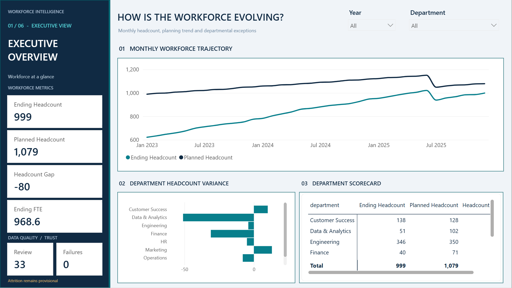
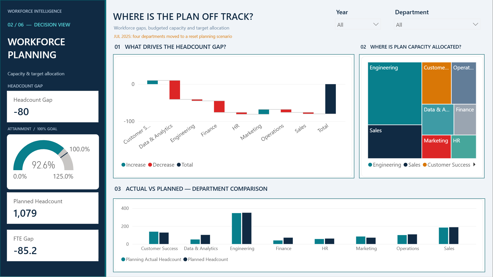
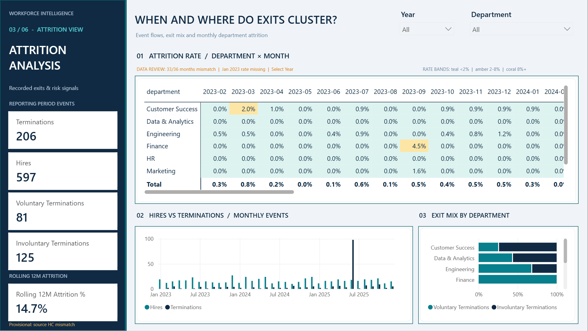
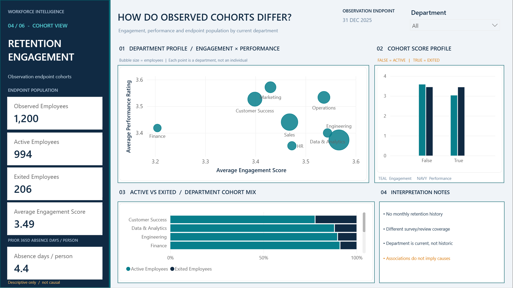
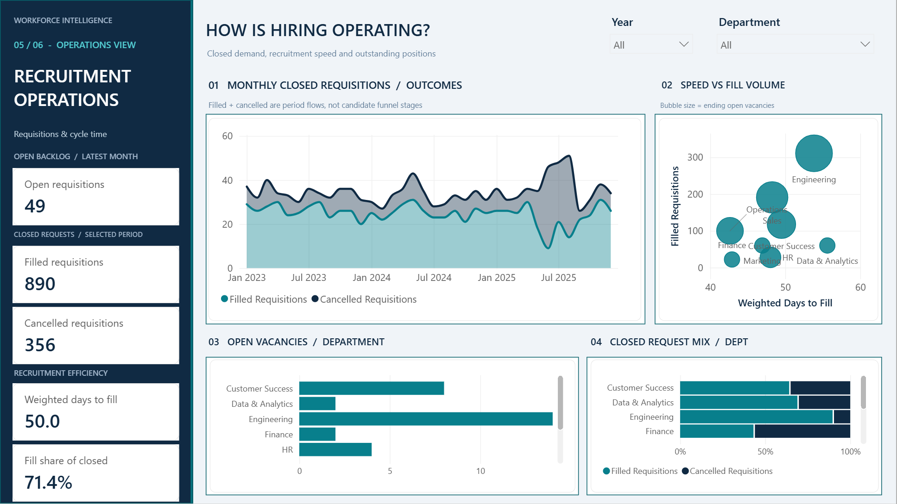
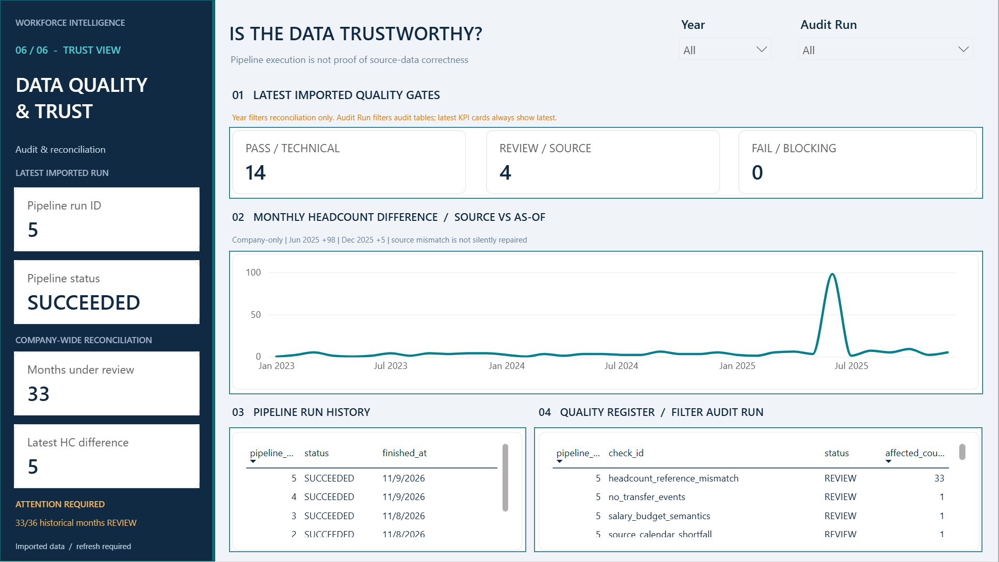

# HR Workforce Intelligence — Power BI Gallery

Six distinct analytical views built on a tested **Python → PostgreSQL → dbt Core → Power BI** data platform.

**Reporting period:** January 2023–December 2025. **Privacy:** The illustrations contain report-level/department-level aggregates and diagnostic counts, not employee-level records. They were captured from the local Power BI Desktop report at the default **All** slicer selections and cropped to the 16:9 report canvas; they are static evidence, not interactive Power BI Service embeds.

[Project overview](../../README.md) · [Case study](case_study.md) · [Three-minute demo guide](demo_walkthrough.md) · [Architecture and trust design](architecture.md)

## 01 — Executive Overview

**Question:** How is the workforce evolving versus plan? The monthly headcount trend reveals the growing capacity gap while the sidebar and department variance ranking establish the executive baseline. **December 2025:** 999 ending headcount versus 1,079 planned (**−80**), 968.6 FTE. Data-trust warnings remain visible.

## 02 — Workforce Planning

**Question:** Where is the staffing plan off track? The waterfall attributes the signed headcount gap across departments; a treemap explains planned allocation and a paired column view compares actual versus planned staffing. **92.6%** latest headcount attainment is a planning metric, not an employee-retention rate.

## 03 — Attrition Analysis

**Question:** When and where do employee exits cluster? A month × department rate heatmap is paired with monthly hires versus terminations and exit-type composition. **June 2025:** 98 recorded exits (96 involuntary, 2 voluntary). January 2023 rates are **blank**, not zero, because the prior-month denominator is unavailable. All supported monthly rates remain **provisional** due to source reconciliation limitations.

## 04 — Retention & Engagement

**Question:** How do observed Active and Exited cohorts differ? Each bubble represents a **department**, not an individual: engagement on X, performance on Y and department population as bubble size. The reporting sample has **1,200** observed employee endpoints: **994 Active / 206 Exited**. The source lacks longitudinal department assignments. These are **descriptive associations, not causal proof or individual risk predictions**.

## 05 — Recruitment Performance

**Question:** How do recruiting workload and speed compare? The area chart describes **filled and cancelled period flows**, while the backlog chart shows **ending open requisitions**, a stock that is not summed across months. Over the historical period there were **890 filled / 356 cancelled**; December 2025 had **49** open requisitions. Weighted days-to-fill is approximately **50 days**. No applicant-funnel conversion claim is made.

## 06 — Data Quality & Trust

**Question:** Did the pipeline execute successfully, and can the source data be trusted? The imported audit snapshot shows **14 PASS / 4 REVIEW / 0 FAIL** for its latest recorded run; the company reconciliation review still covers **33 of 36 months** and includes a **+98** June 2025 mismatch. A technical **SUCCEEDED** status does not eliminate source-data limitations.

## Read the source, not just the screenshots

- **Editable Power BI report and semantic model:** [Power BI project](../../powerbi/WorkforceIntelligence.pbip) and [setup](../../powerbi/README.md)
- **Visual and KPI semantics:** [Power BI documentation](../phase5/README.md) and [validation summary](../../reports/phase5/validation_summary.md)
- **Warehouse and tests:** [dbt project](../../dbt_hr/) and [Phase 3 handoff](../phase3/README.md)
- **Quality gates:** [Phase 4 runbook](../phase4/04_runbook.md) and [synthetic CI workflow](../../.github/workflows/quality-ci.yml)

### Interactive demo status

The owner has published a Power BI Service copy, but a publicly accessible, permission-reviewed report URL has **not** been supplied for this repository. This gallery intentionally links only to local source and static screenshots; it does **not** invent a public share link. Power BI Service imports are not live database monitoring; gateway and refresh scheduling are separate operations.

### Screenshot evidence and limitations

Screenshots were exported in November 2026 from a local Power BI Desktop session using the report's default views, without exposing the Desktop Filters pane or changing unsaved report edits. They represent a **historical demonstration snapshot**; values may differ after a future refresh or filter selection. No original workbook, imported semantic-model cache, employee identifier or connection credential is included in this folder.
