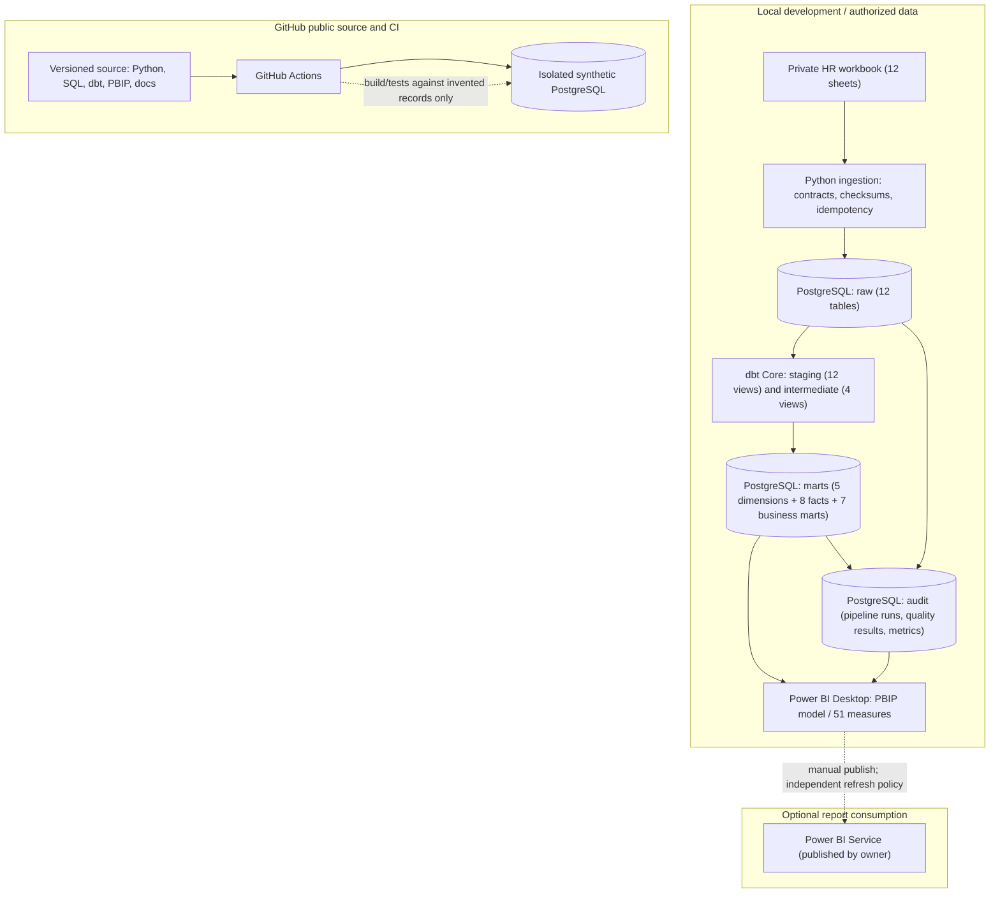

# Architecture and Data Trust

## Implemented topology (Phases 1–5)

The repository does **not** publish source workbook rows, individual-level employee exports, PostgreSQL credentials or imported Power BI cache. GitHub Actions uses a **separate, disposable synthetic database**; it must not be pointed at the private local PostgreSQL database.

## Data model and semantics

| Area | Stored grain | Data contract / analytical caution |
|---|---|---|
| Workforce snapshot | Month × department × location × level | Ending headcount and FTE are **stocks**; sum across departments, not across months |
| Workforce planning | Month × department | Plan comparisons only at source-supported grain; July 2025 plan-reset context |
| Attrition | Month × department | Exits are additive events; rate denominators use prior/current snapshot headcount, January 2023 rate BLANK |
| Retention features | Employee × observation endpoint in SQL, aggregates in Power BI | Endpoint cohorts; no causal claims or longitudinal department history |
| Recruitment | Month × department | Ending open is a **stock**; fills/cancellations are **flows**; days-to-fill is weighted |
| Quality register | Audit run × quality check | PASS / REVIEW / FAIL; affected counts do not represent distinct people |
| Reconciliation | Month at **company** level | Company-only snapshot-vs-as-of difference; not attributable to department |

## Quality gate policy

**BLOCK / FAIL** applies to technical integrity violations such as a broken contract, duplicate grain, missing core tables, or leakage. These conditions should prevent a trusted downstream refresh.

**REVIEW** applies to known historical source limitations requiring business confirmation. The most important example is **33 of 36 months** in which snapshot headcount differs from employee-as-of counts. Neither dbt nor Power BI silently invents corrected employee histories.

**SUCCEEDED** for the technical pipeline means the run completed under this policy. It does **not** mean that all REVIEW issues are fixed.

## Reproducibility and controls

- Python ingestion: source SHA-256 audit, schema checks, transactional writes and rerun safety.
- dbt Core: 36 models with 83 full-data tests, with 3 workbook-specific baselines excluded from synthetic CI; therefore GitHub CI has 116 model/test steps (36 + 80).
- Python and quality tests: source-contract, regression, failure/recovery and privacy checks; Phase 5 offline suite covers semantic model, bindings, six report pages and visual contracts.
- Power BI: native visuals and 51 modeled DAX measures; individual employee information is not exported in the public gallery.
- Self-hosting: the primary stack can run locally without recurring paid cloud services.

For current commands and version pins, see the [root README](../../README.md) and [Phase 4 synthetic CI docs](../phase4/03_ci_workflow.md). For the next *planned* orchestration layer, see the [Dagster extension plan](../phase7/dagster_extension_plan.md).
